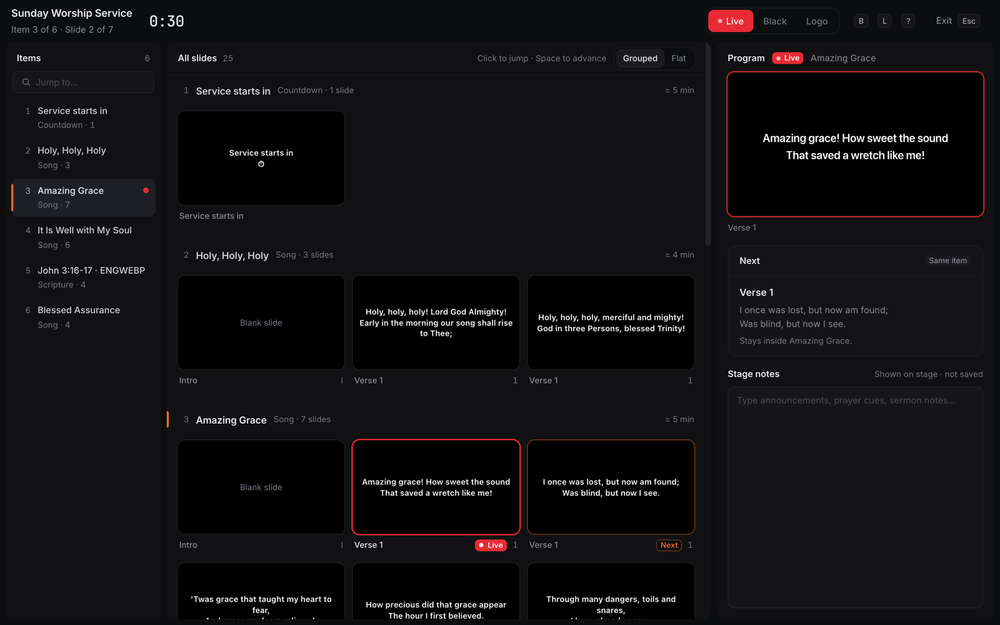
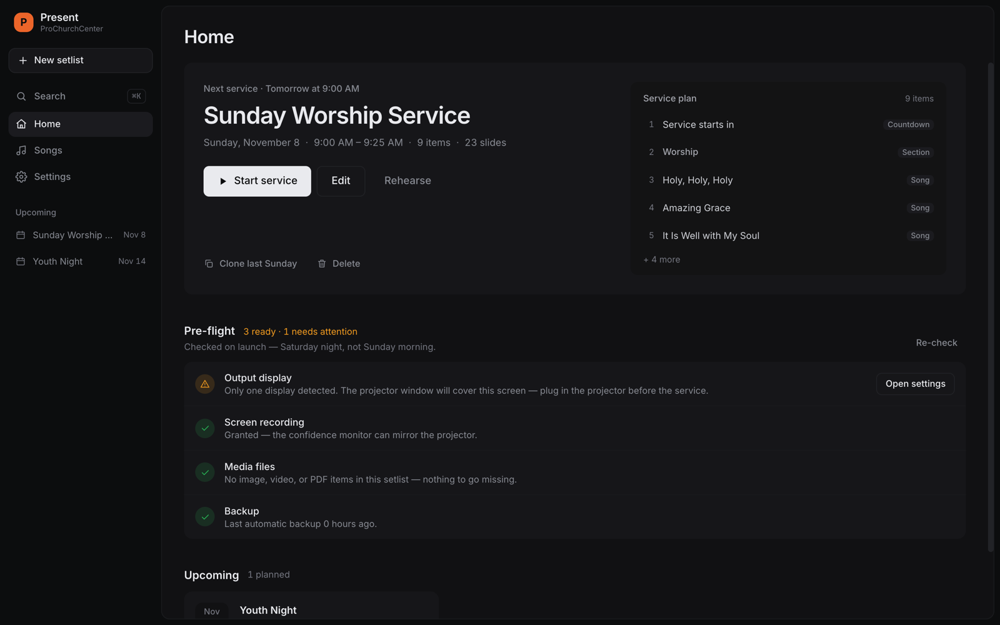
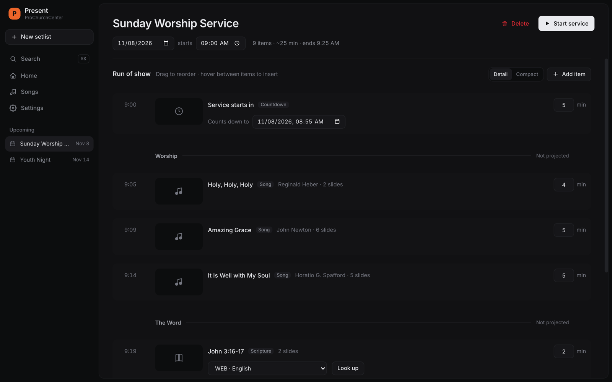
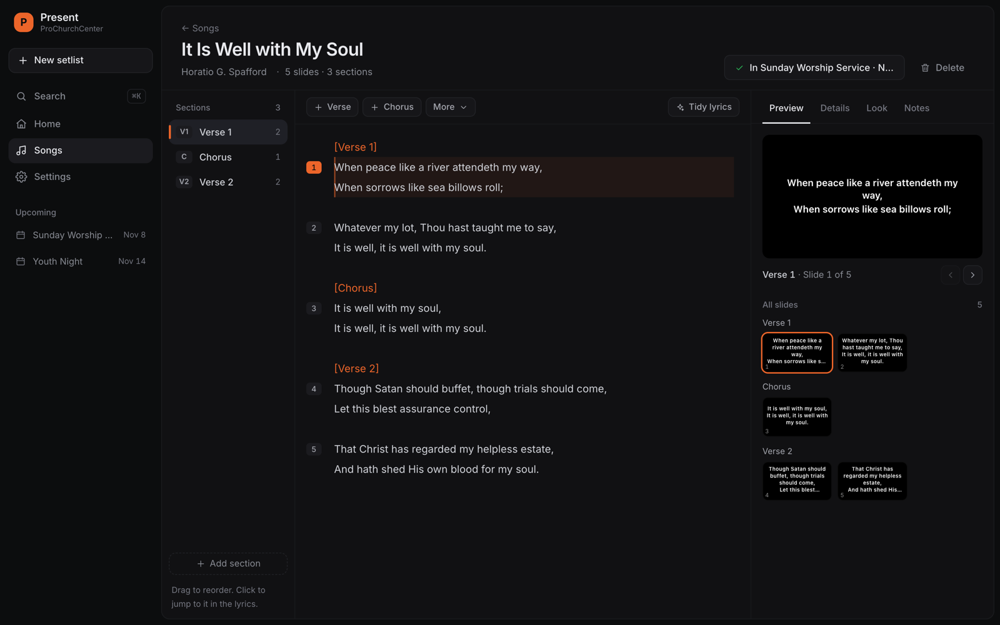
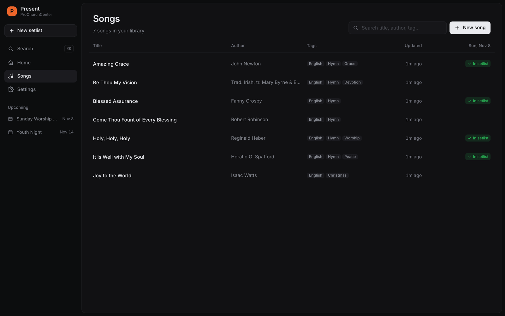
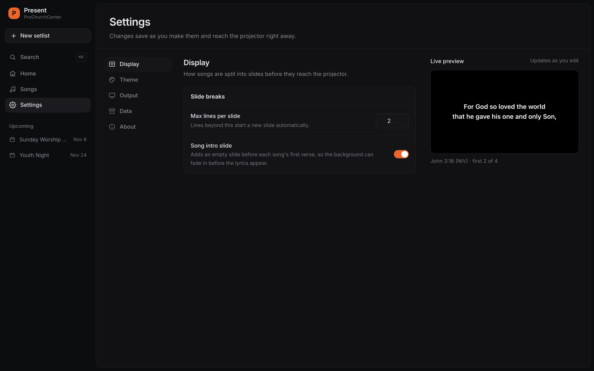

# ProChurchCenter Present

**A free, open-source church presenter built for the Sunday-morning volunteer.**
Deliberately minimal. Offline-first. Made in the Philippines.

[](https://github.com/kalib-code/prochurchcenter-present/releases/latest)
[](./LICENSE)




## Why

Most presentation software is built for production teams. Most church tech teams
are one volunteer on a borrowed laptop. Present is designed around that
volunteer, and every feature has to pass one test:

> *Kaya ba ni Ate Rose gawin 'to nang walang tatanungin?*
> (Can Ate Rose do this without having to ask anyone?)

That means **reliable on Sunday morning, editable on Saturday night, and
learnable in one rehearsal**. There are no save buttons; everything autosaves.
When something goes wrong, it degrades instead of breaking: a missing song is
skipped, an unplugged projector falls back to the main screen, and a dropped
internet connection changes nothing.

## Features

- **Song library.** Type or paste lyrics as plain text with `[Verse]` and `[Chorus]` markers. Slides are split for you, with a live preview.
- **Setlists with a run of show.** Drag to reorder and set durations. Present works out each item's start time and when the service will end.
- **Service Mode.** A focused operator view with Program and Next previews, a slide grid, stage notes, a service clock, and one-key Blackout and Logo.
- **Scripture.** Look up passages in several Bible translations. Fetched passages are cached on disk, so they still project offline.
- **Media and decks.** Project images, videos, countdowns, PDF decks, and PowerPoint `.pptx` files with no export step.
- **Extra outputs.** Projector output, a stage/confidence monitor, and a chroma-key lower-thirds window for livestreams.
- **Themes.** Fonts (including your own uploads), colours, background images or video, text effects, and transitions. You can override the theme per song.
- **Pre-flight check.** Run on launch: it confirms the projector is detected, media files are present, and a backup exists, all before Sunday.
- **Backups.** One-click and automatic backups of your whole library, with safe restore.
- **⌘K command palette.** Jump to any song, setlist, or screen.
- **AI tools (MCP).** Let an AI assistant on your computer, such as Claude Code, help prepare a service: create setlists, add or fix songs, and add scripture and slide decks. It's off by default, local-only, and protected by a token. It can't control the projector or delete anything.

## Screenshots

| Home & pre-flight | Setlist editor |
|---|---|
|  |  |
| **Song editor** | **Song library** |
|  |  |

<details>
<summary>Settings</summary>



</details>

## Install

Download the latest installer for **Windows, macOS, or Linux** from the
[releases page](https://github.com/kalib-code/prochurchcenter-present/releases/latest).

👉 **[Read the installation guide (INSTALL.md)](./INSTALL.md).** The app isn't
code-signed yet, so your computer will show an "unrecognized app" warning on
first launch. The guide explains exactly what to click.

## Keyboard shortcuts (Service Mode)

| Key | Action |
|---|---|
| `Space` / `→` | Next slide |
| `Shift+Space` / `←` | Previous slide |
| `↓` / `↑` | Next / previous item |
| `B` | Blackout on/off |
| `L` | Logo/standby on/off |
| `P` / `M` | Pause / mute the active video |
| `?` | Show the cheat sheet |
| `Esc` | Exit service |

## Development

Requires **Node.js 20+** and **pnpm**.

```bash
git clone https://github.com/kalib-code/prochurchcenter-present.git
cd prochurchcenter-present
pnpm install
pnpm dev          # launches the operator + output windows
```

| Command | What it does |
|---|---|
| `pnpm test` | Unit tests (Vitest) |
| `pnpm typecheck` | Type-checks main, preload, and renderer |
| `pnpm build` | Typecheck + test + production build |
| `pnpm build:mac` / `build:win` / `build:linux` | DMG / NSIS installer / AppImage |

> **"Electron uninstall" on first `pnpm dev`?** Recent pnpm versions block
> postinstall scripts by default, so Electron's binary download may be
> skipped. Run `pnpm setup:electron` once to fetch it.

### Project layout

```
src/
├── main/       Electron main process: windows, IPC handlers, storage, updater
├── preload/    The typed bridge exposed to the renderer
├── renderer/   React UI: operator screens and the output/stage/lower-thirds views
└── shared/     Types, IPC contract, and pure logic (song parser, Bible refs) shared by both sides
```

All user data is plain JSON under Electron's `userData` folder (`library/songs`,
`library/setlists`, `themes`, `media`), written atomically.

### Stack

Electron 34 · electron-vite · React 18 · TypeScript · Tailwind CSS · Zustand ·
react-router · pdf.js · [@aiden0z/pptx-renderer](https://www.npmjs.com/package/@aiden0z/pptx-renderer)

For releases, see [RELEASING.md](./RELEASING.md).

## Contributing

Issues and pull requests are welcome. Before you open a PR:

1. Run `pnpm test` and `pnpm typecheck`.
2. Keep the "Ate Rose" test in mind. Present is deliberately small, so a new
   feature has to earn its place in the UI. Please open an issue to discuss
   larger features first.

## License

[MIT](./LICENSE) © Karl Kenneth Alibuas

Song lyrics shown in the screenshots are public-domain hymns.
